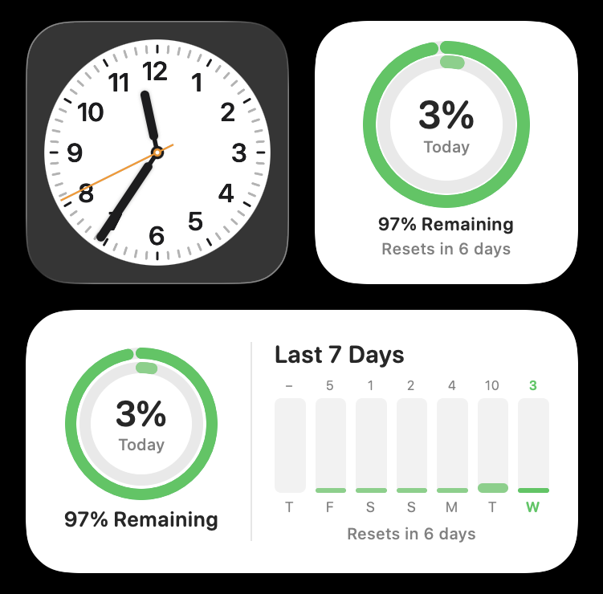
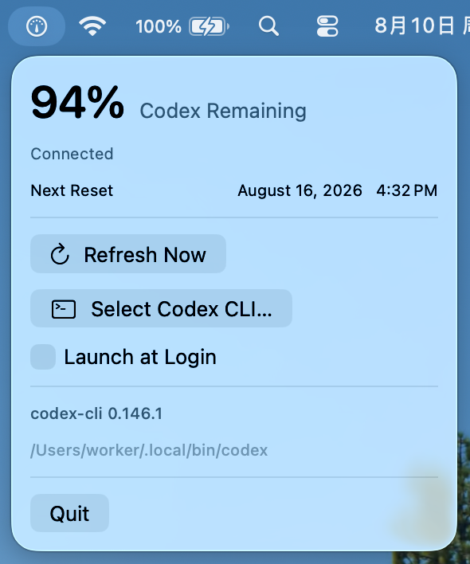

# Codex Usage Widget

A native macOS menu bar app and WidgetKit widget that shows your remaining Codex usage at a glance.

The app connects to the Codex CLI already installed on your Mac, reads the primary Codex usage limit, and shares a small local snapshot with the widget. It does not bundle the Codex CLI or require a separate backend.

## Screenshots

| Desktop widget                                        | Menu bar app                                          |
| ----------------------------------------------------- | ----------------------------------------------------- |
|  |  |

## Features

- Native macOS menu bar app built with SwiftUI
- Small WidgetKit widget with dual rings for today's usage and the remaining limit
- Medium WidgetKit widget with the same dual-ring summary and a seven-day usage chart
- Remaining percentage and next reset time
- Automatic refresh every 15 minutes and on Codex usage updates
- Manual refresh from the menu bar
- Automatic Codex CLI discovery with a manual file picker fallback
- Optional launch at login
- Local-only communication with the installed Codex CLI

## Requirements

- macOS 14 or later
- Xcode 26 for the current development setup
- [XcodeGen](https://github.com/yonaskolb/XcodeGen)
- Codex CLI installed and signed in with a ChatGPT account
- An Apple Development team configured in Xcode, including a free Personal Team

The project may work with older Xcode versions that support macOS 14, but they have not been tested.

## Build from source

### 1. Clone the repository

```bash
git clone https://github.com/zherunliu/codex-usage-widget.git
cd codex-usage-widget
```

### 2. Confirm that Codex CLI is available

```bash
codex --version
```

If you are not signed in yet, run:

```bash
codex login
```

### 3. Configure code signing

Create a local signing configuration:

```bash
cp Config/Local.xcconfig.example Config/Local.xcconfig
```

Open `Config/Local.xcconfig` and replace `YOUR_TEAM_ID` with the development team identifier shown in your Xcode signing settings:

```text
DEVELOPMENT_TEAM = YOUR_TEAM_ID
```

### 4. Generate and open the Xcode project

```bash
xcodegen generate
open CodexUsage.xcodeproj
```

In Xcode:

1. Select the `CodexUsage` scheme.
2. Select `My Mac` as the run destination.
3. Press <kbd>Command</kbd> + <kbd>R</kbd>.

The app appears in the macOS menu bar instead of the Dock. On first launch, it tries to locate the Codex CLI automatically. If discovery fails, use **Select Codex CLI…** and choose the `codex` executable manually.

### 5. Add the widget

1. Right-click the macOS desktop and select **Edit Widgets**.
2. Search for **Codex Usage**.
3. Add **Codex Usage**, then choose the small dual-ring size or the medium
   dual-ring and seven-day chart size.

If macOS continues to show an older widget after rebuilding, remove the widget and add it again to refresh the WidgetKit cache.

## Development workflow

The Xcode project is generated from [`project.yml`](project.yml). Treat that file as the source of truth for targets, build settings, signing, and dependencies.

Pressing <kbd>Command</kbd> + <kbd>R</kbd> does **not** run XcodeGen. It only builds the existing `.xcodeproj` and launches the app. Run the following command again after changing `project.yml`, adding a target, or making another project-structure change:

```bash
xcodegen generate
```

Editing an existing Swift source file does not require regenerating the project.

To run the unit tests in Xcode, choose **Product → Test** or press <kbd>Command</kbd> + <kbd>U</kbd>.

## How it works

```text
CodexUsageApp
    │
    ├── starts `codex app-server --stdio`
    ├── reads the account and primary Codex rate limit
    └── writes a versioned usage snapshot to the shared App Group
                                      │
                                      ▼
                             CodexUsageWidget
                             reads and displays
                             the local snapshot
```

The responsibilities are intentionally separated:

- **Host app:** discovers and validates the Codex CLI, owns the App Server process, refreshes usage, handles login state, and writes the snapshot.
- **Widget extension:** only reads the shared snapshot and renders it. It does not launch subprocesses or manage authentication.
- **Shared core:** contains the usage models, snapshot storage, and response mapping used by both targets.

Only a sanitized usage snapshot is persisted in the App Group container. Codex authentication remains managed by the locally installed Codex CLI.

## Project structure

```text
Config/                 Info.plist, entitlements, and signing configuration
Sources/App/            Menu bar app and application state
Sources/Core/           Codex connection, usage models, and shared storage
Sources/Widget/         WidgetKit timeline provider and widget UI
Tests/CoreTests/        Unit tests for usage mapping and persistence
project.yml             XcodeGen project definition
```

## Current limitations

- ChatGPT authentication is required; API-key authentication does not provide ChatGPT plan usage.
- The widget currently displays only the primary Codex usage limit.
- The host app must run periodically to keep the shared snapshot fresh.
- The project depends on the Codex CLI App Server protocol, so future Codex CLI changes may require compatibility updates.
- A signed and notarized prebuilt release is not available yet; the app currently needs to be built from source.

## Contributing

Issues and pull requests are welcome. Please keep authentication and subprocess work in the host app, keep the widget display-only, and include tests for changes to usage-response mapping.

## License

This project is available under the [MIT License](LICENSE).
